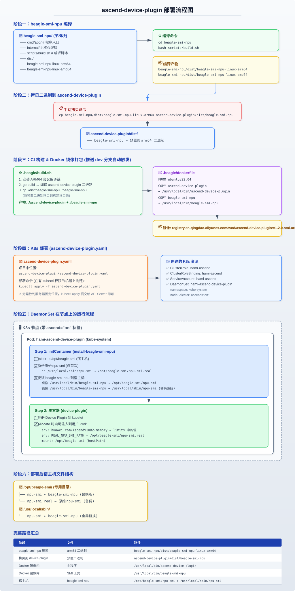

# ascend-device-plugin 部署指南

## 概述

ascend-device-plugin 是华为昇腾 NPU 的 Kubernetes Device Plugin，集成了 `beagle-npu-smi` 用于自定义显存展示。

## 镜像

- 镜像地址：`registry.cn-qingdao.aliyuncs.com/wod/ascend-device-plugin`
- 当前版本：`v1.2.0-smi-arm64`
- 镜像内容：ascend-device-plugin 二进制 + beagle-npu-smi 二进制

## 部署流程图



## 构建流程

1. 推送代码到 `dev` 分支，Drone CI 自动触发
2. 流水线执行 `.beagle/build.sh`：编译 ascend-device-plugin + 拷贝 beagle-npu-smi 二进制
3. 流水线执行 `.beagle/dockerfile`：打包为 Docker 镜像并推送到阿里云 registry
4. 推送到 `main` 分支后，流水线给镜像打正式版本 tag

### 更新 beagle-npu-smi 二进制

如果 beagle-npu-smi（仓库目录 `beagle-smi-npu`）代码有更新：

```bash
# 1. 在 beagle-smi-npu 目录编译
cd beagle-smi-npu
bash scripts/build.sh

# 2. 拷贝新二进制到 ascend-device-plugin
cp dist/beagle-npu-smi-linux-arm64 ../ascend-device-plugin/dist/beagle-npu-smi

# 3. 提交并推送 ascend-device-plugin，触发流水线重新构建镜像
```

## 部署流程

### 首次部署

```bash
kubectl apply -f ascend-device-plugin.yaml
```

这会创建：
- ClusterRole / ClusterRoleBinding / ServiceAccount（RBAC）
- DaemonSet（在所有 `ascend: "on"` 标签的节点上运行）

### 更新部署（镜像内容变化）

如果只是镜像内容更新（tag 不变），需要重启 DaemonSet：

```bash
kubectl rollout restart ds -n kube-system hami-ascend-device-plugin
```

如果镜像 tag 变了或 yaml 有改动（比如加了 initContainer、改了 volume）：

```bash
kubectl apply -f ascend-device-plugin.yaml
```

### 验证部署

```bash
# 检查 DaemonSet 状态
kubectl get ds -n kube-system hami-ascend-device-plugin

# 检查 Pod 状态
kubectl get pod -n kube-system -l app.kubernetes.io/component=hami-ascend-device-plugin

# 检查 initContainer 日志（beagle-npu-smi 安装）
kubectl logs -n kube-system <pod名> -c install-beagle-npu-smi

# 检查宿主机文件
ls -la /opt/beagle-smi/
ls -la /usr/local/sbin/npu-smi /usr/local/sbin/beagle-npu-smi
```

## DaemonSet 启动流程

1. **initContainer (install-beagle-npu-smi)**：
   - 若历史版本曾覆盖 `npu-smi`，从 `/opt/beagle-smi/npu-smi.real` 恢复原生 `npu-smi`
   - 安装独立命令到 `/opt/beagle-smi/beagle-npu-smi` 与 `/usr/local/sbin/beagle-npu-smi`
   - **不覆盖** `/usr/local/sbin/npu-smi`

2. **主容器 (device-plugin)**：
   - 注册 Device Plugin 到 kubelet
   - Allocate 时自动注入 env 和 mount 到用户 Pod

## Allocate 自动注入

当用户 Pod 申请昇腾资源时，Device Plugin 的 Allocate 方法会自动注入：

| 注入项 | 值 | 说明 |
|--------|-----|------|
| env `huawei.com/Ascend910B2-memory` | limits 中的值 | 如果 Pod 已有该 env 则不覆盖 |
| env `REAL_NPU_SMI_PATH` | `/usr/local/sbin/npu-smi` | 原生 npu-smi 路径 |
| mount `/opt/beagle-smi` | hostPath 目录 | 含 `beagle-npu-smi` |
| mount `/usr/local/bin/beagle-npu-smi` | hostPath 文件 | 独立 CLI，配额查询用 |

## 用户 Pod 配置

平台创建 Pod 时需要：

```yaml
spec:
  runtimeClassName: ascend          # 必须，ascend 容器运行时
  containers:
    - env:
        - name: huawei.com/Ascend910B2-memory
          value: "12000"            # 用户原始申请值，防止被 hami 取整值覆盖
      resources:
        limits:
          huawei.com/Ascend910B2: 1
          huawei.com/Ascend910B2-memory: 12000
```

### 关键说明

- `runtimeClassName: ascend`：必须由平台设置，Device Plugin 无法注入
- env `huawei.com/Ascend910B2-memory`：建议由平台设置原始值（如 12000），否则 Allocate 会从 limits 读取（hami 取整后的值如 16384）
- 容器内执行 `beagle-npu-smi info` 时，会读取该 env 并替换 HBM Total 显示值；`npu-smi info` 仍为物理全卡

## 版本管理

| 版本 | 说明 |
|------|------|
| v1.2.0-arm64 | 原始版本，不含 beagle-npu-smi |
| v1.2.0-smi-arm64 | 集成 beagle-npu-smi，支持自定义显存展示 |

修改 `.beagle.yml` 中的 `Version` 字段来更新版本号。
